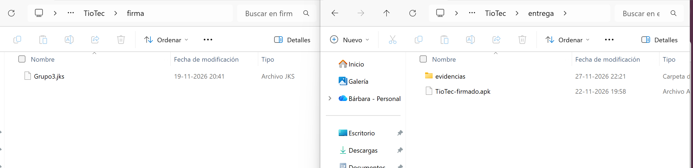

# TíoTec Preventivo

**DSY1105 Desarrollo de Aplicaciones Móviles · Experiencia de Aprendizaje 3**

**Equipo 3**

- Bárbara Tolorza Escobar
- Christopher Jared Villa Vera

## Proyecto

TíoTec Preventivo ayuda a una persona a revisar cuatro hábitos de seguridad digital en su dispositivo. La evaluación pregunta si tiene un respaldo reciente, mantiene el sistema actualizado, utiliza autenticación en dos pasos y cuenta con un método de recuperación de su cuenta. A partir de sus respuestas, la app genera un plan de acciones que la persona puede consultar y marcar como completadas.

Para la demostración se utilizan perfiles y dispositivos ficticios.

## Funcionalidades

| Sección | Qué permite hacer |
|---|---|
| Evaluar | Registrar un dispositivo, tomar o elegir una foto y responder las cuatro preguntas. El formulario indica qué campos se deben corregir. |
| Historial | Consultar las evaluaciones guardadas en el teléfono, editarlas, eliminarlas y actualizar el avance del plan. |
| Servidor | Crear, consultar, editar y eliminar evaluaciones almacenadas en el microservicio Spring Boot. |
| Mi sistema | Elegir Android o Windows y consultar el estado de soporte de una versión mediante la API externa endoflife.date. |

## Organización del código

La aplicación Android está desarrollada en Kotlin con Jetpack Compose y Material 3. Las pantallas muestran el estado que mantienen los ViewModel mediante StateFlow. Los repositorios acceden a los datos locales con Room y a los servicios HTTP con Retrofit.

El código Android está en `app/src/main/java/com/example/tiotec`.

| Carpeta | Contenido |
|---|---|
| `ui/screens` | Pantallas de la aplicación |
| `viewmodel` | Estado de las pantallas y operaciones que se ejecutan desde ellas |
| `repository` | Acceso a las evaluaciones y al catálogo de soporte |
| `data/remote` | Interfaces HTTP en `ApiService.kt` y configuración de las conexiones en `RetrofitInstance.kt` |
| `data/model` | Datos de los formularios y respuestas de las APIs |
| `data` | Base de datos Room y almacenamiento de fotos |
| `validation` | Validación del formulario local |

El backend está en `backend/src/main/java/cl/tiotec`. La clase `RevisionesApplication.java` inicia Spring Boot. El paquete `revision` contiene el controlador HTTP, el servicio, el repositorio JPA, la entidad y los datos de entrada y salida.

En Android, la sección **Servidor** utiliza `ServidorScreen.kt`, `ServidorViewModel.kt` y `ServidorRepository.kt`. La sección **Historial** utiliza su propio repositorio para guardar las evaluaciones en el dispositivo.

## Endpoints utilizados

### Microservicio propio en Spring Boot

| Método | Ruta | Función |
|---|---|---|
| GET | `/api/salud` | Comprobar que el servidor responde |
| GET | `/api/revisiones` | Obtener la lista de evaluaciones |
| GET | `/api/revisiones/{id}` | Consultar una evaluación por su identificador |
| POST | `/api/revisiones` | Crear una evaluación |
| PUT | `/api/revisiones/{id}` | Editar una evaluación |
| DELETE | `/api/revisiones/{id}` | Eliminar una evaluación |

Al crear o editar una evaluación, la app envía el nombre, los datos del dispositivo y del sistema, la experiencia, el plazo, las cuatro respuestas y el avance de las acciones. El servidor valida los campos y devuelve el registro con su identificador y fecha.

### API externa endoflife.date

| Método | URL | Función |
|---|---|---|
| GET | `https://endoflife.date/api/v1/products/android/` | Consultar versiones de Android y sus datos de soporte |
| GET | `https://endoflife.date/api/v1/products/windows/` | Consultar versiones de Windows y sus datos de soporte |

La sección **Mi sistema** descarga el catálogo y permite elegir una versión para ver su estado de soporte y las fechas disponibles. Los valores que la fuente no informa se muestran como desconocidos.

## Cómo ejecutar el proyecto

Se utiliza Android Studio, Java 21 para Gradle, Android SDK 35 y un emulador o teléfono con Android 13 (API 33) o superior. La primera sincronización de Gradle requiere conexión a internet.

### 1. Abrir el proyecto Android

Extraer el ZIP. En Android Studio, elegir **Open** y seleccionar la carpeta `TioTec` que contiene `settings.gradle.kts` y la carpeta `app`. Esperar a que termine la sincronización de Gradle. Android Studio genera `local.properties` con la ubicación del SDK del equipo.

### 2. Iniciar el backend

Abrir una terminal en la carpeta `backend`. Para ejecutar el microservicio con Maven, usar:

```powershell
mvn spring-boot:run
```

También se puede ejecutar el JAR incluido, desde la misma carpeta:

```powershell
java -jar target/revisiones-1.1.0.jar
```

Elegir una de las dos formas de inicio. Mantener el servidor en ejecución y abrir `http://localhost:8080/api/salud` en el navegador del computador para comprobar que responde.

### 3. Ejecutar la app

En Android Studio, seleccionar un emulador, elegir el módulo `app` y presionar **Run**. También se puede instalar el APK incluido en `entrega/TioTec-firmado.apk`.

El emulador Android estándar se conecta al backend del computador mediante `http://10.0.2.2:8080/`. Para usar un teléfono conectado por USB con la dirección `http://127.0.0.1:8080/`, ejecutar en el computador:

```powershell
adb reverse tcp:8080 tcp:8080
```

### 4. Comprobar las dos conexiones

- **Microservicio propio.** Entrar a **Servidor**, crear una evaluación y presionar **Actualizar**. Comprobar que la evaluación aparece en la lista. Desde la misma pantalla se puede editar o eliminar.
- **API externa.** Con conexión a internet, entrar a **Mi sistema**, elegir Android o Windows y consultar el soporte de una versión.

## Almacenamiento

Room guarda el historial local y las rutas de las fotos. Las imágenes se copian al almacenamiento privado de la app.

El microservicio utiliza H2 en archivo. Al iniciarlo desde `backend`, la base queda en `backend/datos/revisiones.mv.db` y conserva las evaluaciones al reiniciar el servidor.

## Pruebas

Las pruebas de lógica Android se encuentran en `app/src/test/java`. Se utilizan Kotest, MockK y `kotlinx-coroutines-test` para probar los ViewModel y repositorios con dependencias simuladas. Las pruebas JUnit 4 se ejecutan en JUnit Platform mediante Vintage.

Desde la carpeta `TioTec`, ejecutar las pruebas unitarias y generar el informe de cobertura con:

```powershell
.\gradlew.bat testDebugUnitTest coberturaLogica
```

El informe JaCoCo se genera en `app/build/reports/jacoco/coberturaLogica`. La tarea verifica un mínimo del 80 % de cobertura de líneas en ViewModel y Repository.

Las cinco pruebas de pantalla se encuentran en `app/src/androidTest/java` y utilizan `createAndroidComposeRule`. Se ejecutaron en el emulador API 37 el 25 de noviembre de 2026. El resultado está en `entrega/evidencias/pruebas-pantalla.txt`. Para repetirlas con un emulador o teléfono conectado:

```powershell
.\gradlew.bat connectedDebugAndroidTest
```

El backend incluye pruebas de integración con MockMvc y H2 en memoria. Para ejecutarlas, abrir una terminal en `backend` y usar:

```powershell
mvn test
```

El detalle de las verificaciones se encuentra en `entrega/evidencias/VERIFICACION.txt`.

## APK firmado

El APK de entrega está en `entrega/TioTec-firmado.apk`. La llave académica está en `firma/Grupo3.jks` y su alias es `tiotec`. El archivo `entrega/evidencias/firma-apk.txt` contiene la verificación del certificado.

Para generar el APK desde Android Studio:

1. Abrir **Build > Generate Signed App Bundle / APK**.
2. Elegir **APK**.
3. Seleccionar `firma/Grupo3.jks`, indicar el alias `tiotec` e ingresar las credenciales de firma.
4. Elegir la variante **release** y generar el archivo.

La configuración de firma `Grupo3` está en `app/build.gradle.kts` y lee los datos de `firma.properties`. Con esa configuración también se puede generar el APK desde la raíz del proyecto:

```powershell
.\gradlew.bat assembleRelease
```

### Captura del APK firmado y de la llave



## Trabajo en equipo

- [Repositorio GitHub del equipo e historial de commits](https://github.com/Bartolo18/TioTec-Preventivo-Equipo)
- [TíoTec Parciales 4 y 5](https://trello.com/b/e0OPKumv/tiotec-parciales-2-y-3)
