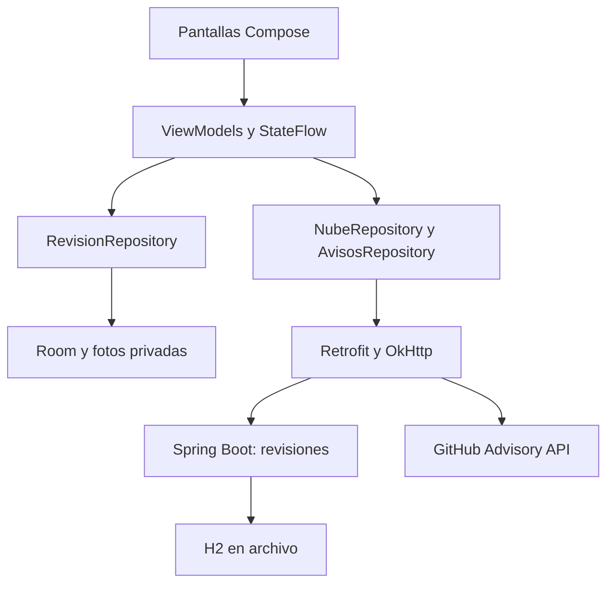

# Documentación técnica

## Alcance

Aplicación Kotlin con Jetpack Compose Material 3 para revisar hábitos digitales en perfiles y dispositivos ficticios. Se conserva la funcionalidad local original y se agregan evaluaciones remotas y avisos públicos.

## Componentes



Cada evaluación es el único dominio remoto que necesita esta versión. Se implementa un microservicio cohesivo, con controlador, servicio, repositorio JPA, entidad y DTO de entrada/salida.

## Endpoints propios

En emuladores Android estándar se usa `http://10.0.2.2:8080/`, alias del loopback del PC. En un dispositivo físico se usa `http://127.0.0.1:8080/`, mediante `adb reverse tcp:8080 tcp:8080`. El servicio escucha solamente en el loopback del PC; no se abre a la red de la sala.

| Método | Ruta | Resultado |
|---|---|---|
| GET | /api/salud | Estado del servicio |
| GET | /api/revisiones | Lista ordenada por fecha e ID |
| GET | /api/revisiones/{id} | Una evaluación o 404 |
| POST | /api/revisiones | Creación, 201 y Location |
| PUT | /api/revisiones/{id} | Actualización completa; no crea un ID inexistente |
| DELETE | /api/revisiones/{id} | Eliminación, 204; 404 si no existe |

Ejemplo de cuerpo:

```json
{
  "nombre": "Perfil Luffy",
  "dispositivo": "Notebook de prueba",
  "sistema": "Windows 11",
  "experiencia": "Básico",
  "diasRevision": 30,
  "respuestas": ["No", "Sí", "No sé", "Sí"],
  "accionesHechas": 0
}
```

La respuesta agrega `id` y `fecha`. Las fotos no se transmiten al servidor. El servicio normaliza espacios, valida los cuatro hábitos y descarta marcas de acción para respuestas “Sí”. La fecha de creación se conserva al editar.

## API externa

`GET https://api.github.com/advisories?per_page=6&ecosystem=maven`.

La sección Avisos muestra identificador GHSA, resumen, gravedad y fecha, con enlace a la fuente. Es una consulta a avisos de dependencias del ecosistema Maven, no un escaneo del dispositivo. Retrofit usa un cliente separado del microservicio, con tiempos máximos de conexión y respuesta. Se distinguen errores HTTP de problemas de conexión y se permite reintentar.

Documentación oficial: https://docs.github.com/en/rest/security-advisories/global-advisories

## Persistencia

- Room conserva evaluaciones locales y rutas de fotos. Se mantiene la migración 1 a 2.
- Las fotos se copian al espacio privado de la app, con límite de tamaño y reducción de resolución.
- El backend utiliza `jdbc:h2:file:./datos/revisiones`. Los datos sobreviven al reinicio mientras se conserve la carpeta `datos`.
- Las pruebas del backend usan una base H2 en memoria independiente.
- No hay sincronización automática ni mezcla entre registros locales y remotos; las dos secciones indican dónde guardan los datos.

## Seguridad y límites del contexto académico

La aplicación solicita internet y cámara; la cámara es opcional porque existe selector de galería. HTTP se permite únicamente para loopback; la API pública usa HTTPS. Se conserva la confirmación antes de eliminar desde la interfaz.

El servicio académico no implementa usuarios ni autorización por registro: se usa con datos ficticios en un PC y dispositivos conectados por ADB. Para un despliegue multiusuario se necesitan autenticación, autorización, HTTPS de extremo a extremo y una estrategia de migración de base de datos. No está publicado como servicio de producción.

La llave de firma y sus contraseñas se entregan para reproducir la versión académica y se excluyen del control de versiones público. No cambiar la llave si se pretende actualizar una instalación firmada con ella.

## Pruebas

Las pruebas del móvil ejercitan validación, repositorios, estados de carga, errores, creación, edición, eliminación y almacenamiento local mediante dobles de prueba. La cobertura se mide con JaCoCo sobre `model`, `validation`, `repository` y `viewmodel`; la interfaz y los adaptadores de plataforma se verifican mediante ejecución del APK.

El backend se prueba con MockMvc y una base JPA real en memoria: HTTP simulado dentro del proceso, sin abrir un puerto de red. Se comprueban CRUD, códigos de estado, campos inválidos, recorte de espacios y conservación de fecha.
